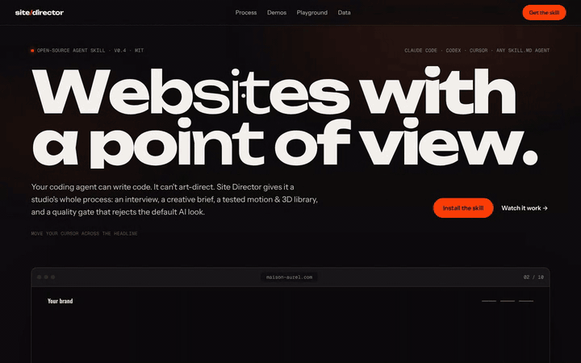

<h1 align="center">Site Director</h1>

<p align="center"><strong>Award-level art direction, motion and 3D for any AI coding agent.</strong></p>

<p align="center">
  <a href="https://mdashfaqh14.github.io/site-director/"></a>
</p>

<p align="center">
  <a href="https://mdashfaqh14.github.io/site-director/"><b>Live website</b></a> ·
  <a href="https://mdashfaqh14.github.io/site-director/examples/aurel-cinematic-3d/">Aurel (3D demo)</a> ·
  <a href="https://mdashfaqh14.github.io/site-director/examples/tracewell-dark-signal/">Tracewell</a> ·
  <a href="https://mdashfaqh14.github.io/site-director/examples/nordform-swiss/">Nordform</a> ·
  <a href="assets/site-director-tour.mp4">Full 60s tour (MP4)</a>
</p>

<p align="center">
  
  
  
</p>

Your agent can write code. It can't art-direct. Ask it for a website and you get the same page everyone gets: a purple gradient, three cards, fade-up on everything.

Site Director gives your agent the process of a top digital studio:

1. **It interviews you** with a few sharp questions about feeling, personality, assets and ambition.
2. **It writes a creative brief** with one art direction, one hero concept and one *signature moment* people will remember.
3. **It builds** with a tested recipe library: line reveals, clip-path wipes, pinned chapters, horizontal scroll, scroll-scrubbed video, magnetic cursors, preloaders, shader backgrounds, Three.js heroes. Every recipe respects reduced motion and touch devices.
4. **It checks its own work** against an anti-slop, craft, performance and accessibility quality gate.
5. **It never repeats itself:** every site's fingerprint is recorded, and the next one must be meaningfully different.

## Built on data, not vibes

The rules aren't guesses. Award-winning sites from Awwwards, Godly, Dark.design, Land-book and MaxiBestOf were opened in a real browser and measured: which libraries they use, their type scales and letter-spacing, colour restraint, masking, blending and pacing. See [`knowledge/reference-analysis.md`](knowledge/reference-analysis.md).

## See it

**Project website:** `index.html` at the repo root, built with Site Director itself (direction: Kinetic Type). Its signature moment restyles one hero live through all 10 art directions. Live at **https://mdashfaqh14.github.io/site-director/** once GitHub Pages is enabled (Settings → Pages → deploy from branch `main`, folder `/`).

Three demo sites, each generated by following the skill. Same tool, three completely different results:

| Demo | Direction | Signature moment |
|---|---|---|
| **Nordform**, architecture studio | Swiss Precision | project index where a composition follows the cursor |
| **Tracewell**, developer tool | Dark Signal | an agent session replays and its false "fixed" claim gets caught |
| **Aurel**, fragrance house | Cinematic Luxury + 3D | a liquid-gold sculpture turns in front of a giant title |

Open `examples/<demo>/index.html` in a browser. Each has its `BRIEF.md` next to it, and `examples/.site-director/history.json` shows the anti-repetition fingerprints of all four sites.

## 10 art directions

Swiss Precision · Cinematic Luxury · Dark Signal · Editorial Serif · Immersive Spatial · Kinetic Type · Soft Tech Minimal · Brutalist Raw · Retro-Futurist Terminal · Organic Warm

Each one is a complete design language: type pairings (free fonts), colour rules, grid, motion personality, 3D usage, signature moves, and a list of things it forbids.

## Install

Works with any agent that supports skills (`SKILL.md`): Claude Code, Codex, Cursor and others.

```bash
# Claude Code (project)
git clone https://github.com/mdashfaqh14/site-director .claude/skills/site-director
```

Then ask your agent: *"Use site-director to build a website for my studio."*

## Status

v0.4: interview, brief, 10 art directions, measured reference analysis, quality gate, anti-repetition memory, **tested motion & 3D recipe library** (GSAP 3.15, Lenis 1.3, Three.js r187), three demo sites, project website.

Coming next: Framer-level interaction patterns, automated screenshot review script, Next.js starter, more art directions.

## Principles

- Learn from references; never copy them.
- One signature moment per site.
- Motion must respect `prefers-reduced-motion`.
- Premium means restraint, not more effects.

## License

MIT
